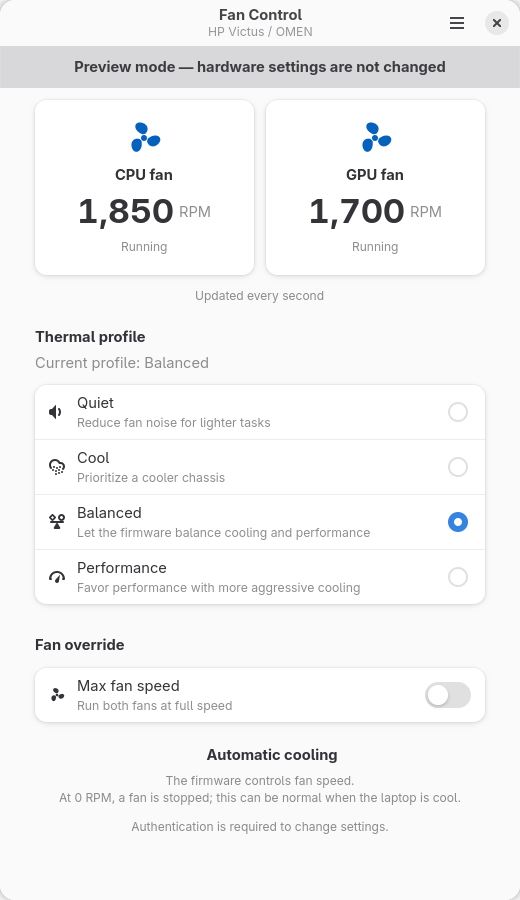
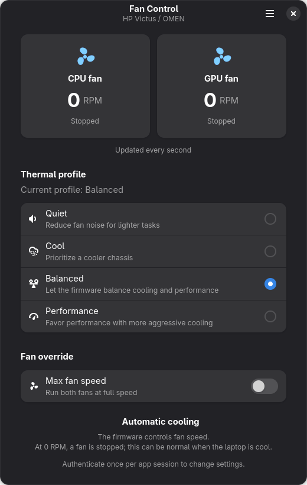

# Fan Control

A GTK 4 / libadwaita app for supported HP Victus and OMEN laptops running Linux. Choose a firmware thermal profile, switch both fans between maximum speed and automatic control, and see their RPM readings update every second.

<p>
  
  
</p>

## Install

Open the [Flatpak installer](https://sh7vansh.github.io/victus-fan-control/fan-control.flatpakref) in GNOME Software, or run:

```sh
flatpak install --user https://sh7vansh.github.io/victus-fan-control/fan-control.flatpakref
flatpak run io.github.sh7vansh.VictusFanControl
```

On first use, select **Enable Service**, authenticate through polkit, and restart the app when prompted. Cooling changes then work without repeated password prompts.

Requires compatible HP firmware and the Linux `hp-wmi` driver, Flatpak, systemd, polkit (`pkexec`), coreutils, and a graphical authentication agent. The app bundles its Go helper and uses the GNOME runtime; you do not need Python or Go installed on the host.

The Flatpak uses `flatpak-spawn --host` to read hardware and manage the service. This allows commands outside the sandbox as your user, which GNOME Software labels **“Potentially Unsafe.”** See [packaging details](packaging/README.md) for permissions and deployment information.

## Use

| Control | What it does |
| --- | --- |
| Quiet, Cool, Balanced, Performance | Selects a firmware policy for power and cooling. Only profiles supported by your laptop are enabled. |
| Max fan speed on | Runs both fans at maximum speed. |
| Max fan speed off | Restores firmware automatic fan control. |
| Fan readings | Shows each fan's RPM. Zero means stopped; unreadable values appear as unavailable. |

These controls do not provide custom fan curves or exact RPM targets. Available controls and fan speeds depend on your laptop and firmware.

**Closing the app leaves the current settings active.** Turn off **Max fan speed** to restore automatic cooling before closing. Firmware or power management may change settings later, including at reboot.

After an app update, select **Background Service… → Update Service** to refresh the installed helper, then restart the Flatpak app.

## How it works

The Python interface reads the laptop's state without administrator privileges. In Flatpak, it runs the bundled Go helper on the host for these reads. The app discovers the HP fan controller through `hp-wmi`, so changing `hwmon` numbers after a reboot is handled automatically.

When you change a setting, the app sends a request through a local Unix socket to a Go service running as root. The service validates the request and writes to Linux's hardware interfaces:

- Thermal profiles use `/sys/firmware/acpi/platform_profile` and must appear in `platform_profile_choices`.
- Maximum fan speed writes `0` to the HP controller's `pwm1_enable`; automatic control writes `2`.
- RPM readings come from `fan1_input` and `fan2_input`.

The app reads settings back after a change and reports if they did not stay applied. It also reflects changes made by firmware or other apps without continuously reapplying settings. After a successful profile change, it tries to update GNOME's power mode through the desktop power-profile service: Quiet → Power Saver, Balanced → Balanced, Performance → Performance. Cool has no desktop mapping.

Enabling the service installs a root-owned helper at `/usr/local/libexec/victus-fan-control/helper` and the `victus-fan-control.service` systemd unit. The service starts at boot and keeps running when the window closes. Its private `/run/victus-fan-control.sock` socket accepts only the account that enabled it and root, with access shared by all processes running as that account. Requests contain only supported settings, never file paths or commands.

## Run from source

On Fedora, install the dependencies, then build the helper and launch the app from this directory:

```sh
sudo dnf install python3-gobject gtk4 libadwaita polkit golang
/usr/bin/python3 packaging/build_helper.py --test
/usr/bin/python3 -m fan_control
```

Go 1.22+ is required to build the helper. Source runs use the same background service; enable it from the app to change settings.

To preview the interface with simulated data, without accessing hardware:

```sh
/usr/bin/python3 -m fan_control --demo
```

Run the backend tests and a simulated UI check:

```sh
/usr/bin/python3 -m unittest discover -s tests -v
/usr/bin/python3 -m fan_control --smoke-test
```

See [packaging/README.md](packaging/README.md) for Flatpak builds, releases, and additional checks.

## Uninstall

First select **Background Service… → Disable Service** to remove the host service and helper. Then remove the app:

```sh
flatpak uninstall --user io.github.sh7vansh.VictusFanControl
```

Uninstalling the Flatpak alone leaves the service installed. Disabling the service or removing the app does not reset firmware settings.

[Project page](https://sh7vansh.github.io/victus-fan-control/) · [Releases](https://github.com/sh7vansh/victus-fan-control/releases) · [Report a problem](https://github.com/sh7vansh/victus-fan-control/issues)

[MIT license](LICENSE). The bundled Go runtime uses the [Go BSD license](data/licenses/Go-LICENSE).
